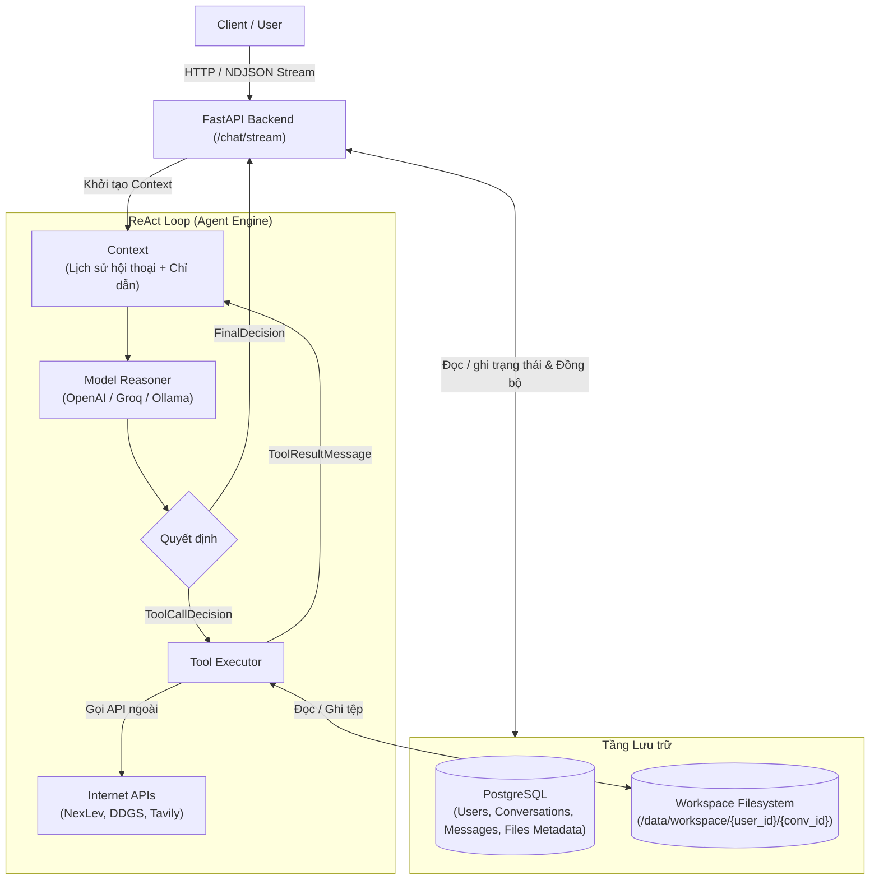

# MCI Agent

> **MCI Agent** là hệ thống AI Agent hỗ trợ nghiên cứu nội dung và kịch bản. Hệ thống vận hành theo cơ chế ReAct, kết hợp không gian lưu trữ tệp tin riêng biệt cho từng phiên làm việc.

---

## Cơ chế hoạt động cốt lõi

### ReAct Loop
Agent vận hành theo chu trình lặp:
1. **Lập luận**: Phân tích yêu cầu dựa trên ngữ cảnh hội thoại, lịch sử trao đổi và các chỉ dẫn nhiệm vụ.
2. **Quyết định**:
   - Khi đủ dữ kiện: Trả về kết quả cuối cùng (`FinalDecision`).
   - Khi cần tra cứu thông tin hoặc thao tác lưu trữ: Sinh danh sách gọi công cụ (`ToolCallDecision`).
3. **Thực thi**: `ToolExecutor` chạy các công cụ (tìm kiếm web, tải phụ đề, đọc/ghi tệp tin...) và đưa phản hồi (`ToolResultMessage`) trở lại ngữ cảnh để tiếp tục vòng lặp suy luận.
4. **Streaming**: Toàn bộ chuỗi sự kiện (`thinking`, `tool_call`, `tool_result`, `done`) được truyền trực tiếp về client dưới định dạng NDJSON qua endpoint `/chat/stream`.

### Isolated Workspace
- Mỗi phiên hội thoại được cấp một thư mục vật lý độc lập trên ổ đĩa (`AGENT_ROOT_WORKSPACE/{user_id}/{conversation_id}`).
- Toàn bộ tư liệu thu thập (phụ đề video, bài báo, ghi chép phân tích, dàn ý) được lưu trữ trực tiếp tại workspace này.
- Dữ liệu lớn không đưa toàn bộ vào ngữ cảnh của mô hình. Agent sử dụng công cụ tìm kiếm và đọc phân trang theo dòng (`start_line`, `end_line`) để tối ưu hóa ngữ cảnh.
- Sau mỗi lượt suy luận, `WorkspaceSyncService` quét cây thư mục trên ổ đĩa và đồng bộ trạng thái tệp tin vào cơ sở dữ liệu PostgreSQL.

---

## Bộ công cụ thực thi

Agent tương tác với môi trường bên ngoài và hệ thống tệp thông qua các công cụ cấu hình tại `src/bootstrap.py`:

| Nhóm công cụ | Tên Tool | Mô tả chức năng |
| :--- | :--- | :--- |
| **Thu thập Web** | `ddgs_web_search` | Tìm kiếm dữ liệu web qua DuckDuckGo không phụ thuộc API key. |
| | `tavily_open_url` | Đọc nội dung bài viết từ URL và chuyển đổi thành văn bản Markdown lưu vào workspace. |
| **YouTube Intelligence** | `nexlev_youtube_search` | Tìm kiếm video YouTube nhiều view theo từ khóa thông qua NexLev API, tránh giới hạn IP từ YouTube. |
| | `nexlev_youtube_transcript` | Tải phụ đề đầy đủ của video và lưu thành tệp tin trong workspace. |
| | `nexlev_youtube_comments` | Trích xuất bình luận tiêu biểu để khảo sát góc nhìn và phản ứng của người xem. |
| **Hệ thống tệp** | `list_files` / `search_files` | Liệt kê cây thư mục và tìm kiếm nội dung theo từ khóa trong workspace. |
| | `read_file` | Đọc nội dung file với tham số `start_line` và `end_line` giúp phân trang đọc an toàn. |
| | `write_file` | Khởi tạo file mới và ghi nội dung vào đường dẫn chỉ định. |
| | `patch_file` | Cập nhật một đoạn văn bản cụ thể bên trong file mà không cần ghi đè toàn bộ. |
| | `move_path` / `rename_path` | Di chuyển hoặc đổi tên tệp/thư mục an toàn bên trong workspace. |
| | `get_file_info` | Kiểm tra kích thước, định dạng và số dòng của tệp tin. |

---

## Quy trình nghiên cứu mẫu

1. **Phân tích đề bài (`<chu-de>/ke-hoach.md`)**:
   Xác định khái niệm trọng tâm, kiểm tra thông tin sơ bộ qua web search, thiết lập các biến thể tên gọi và chuẩn bị danh mục phân loại nội dung.
2. **Thu thập nguồn tư liệu (`<chu-de>/sources/...`)**:
   Tìm kiếm bài viết và video liên quan, tải nội dung và phụ đề về lưu trữ trực tiếp dưới dạng tệp tin trong workspace.
3. **Đọc tư liệu và trích xuất thông tin (`<chu-de>/insights/...`)**:
   Đọc tệp tin theo từng phân đoạn dòng, chọn lọc các chi tiết trọng tâm, phân loại nội dung và loại bỏ thông tin quảng cáo, thương mại.
4. **Đối chiếu và kiểm chứng số liệu**:
   So sánh chéo thông tin giữa các nguồn tài liệu để phát hiện dữ liệu xung đột hoặc thiếu đồng nhất, ghi nhận cảnh báo nếu có mâu thuẫn.
5. **Hoàn thiện dàn ý (`<chu-de>/dan-y-kich-ban.md`)**:
   Tổng hợp toàn bộ thông tin đã xác minh để lập khung dàn ý chi tiết theo từng mốc thời lượng.

---

## Kiến trúc hệ thống



---

## Cấu trúc mã nguồn

```text
src/
├── dom/                               # DOMAIN: Định nghĩa nghiệp vụ cốt lõi
│   ├── entities/                      # User, Conversation, Message, File, Skill, Feedback
│   ├── decision/                      # FinalDecision, ToolCallDecision
│   ├── message/                       # TextMessage, ToolCallMessage, ToolResultMessage
│   ├── context.py                     # Quản lý Context đưa vào LLM
│   └── tool.py                        # Giao diện cơ bản của Tool
├── app/                               # APPLICATION: Điều phối luồng nghiệp vụ
│   ├── ports/                         # ModelReasoner interface
│   ├── services/                      # AgentService, WorkspaceService, WorkspaceSyncService, ToolExecutor...
│   └── usecases/                      # ChatUseCase, ConversationManagement, FileManagement...
├── inf/                               # INFRASTRUCTURE: Triển khai kỹ thuật
│   ├── model_reasoner/                # Tích hợp OpenAI, Groq, Ollama
│   └── tools/                         # Bộ công cụ Web, YouTube (NexLev), File Workspace
├── pre/                               # PRESENTATION: Giao tiếp bên ngoài
│   ├── api/                           # FastAPI Router (Chat streaming NDJSON, Files, Conversations...)
│   ├── call_api/                      # HTTP Client SDK
│   ├── streamlit_ui/                  # Streamlit Interface
│   └── cli/                           # Terminal runner
├── bootstrap.py                       # Khởi tạo DI Container, Model Reasoner và đăng ký Active Tools
└── config.py                          # Cấu hình hệ thống & Logger
```
